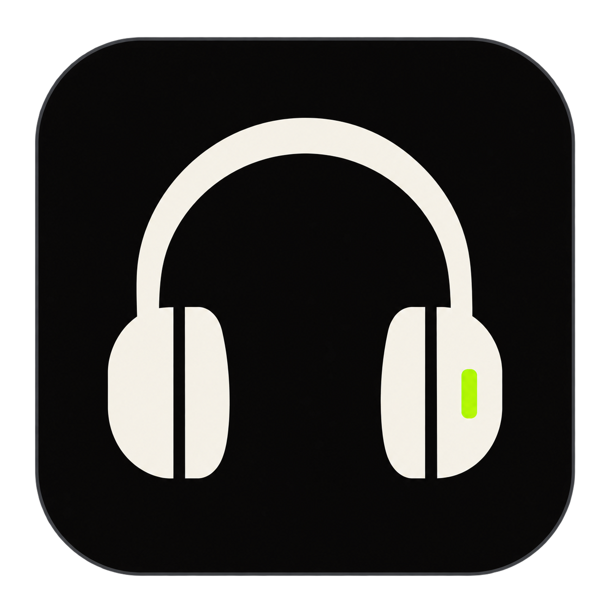
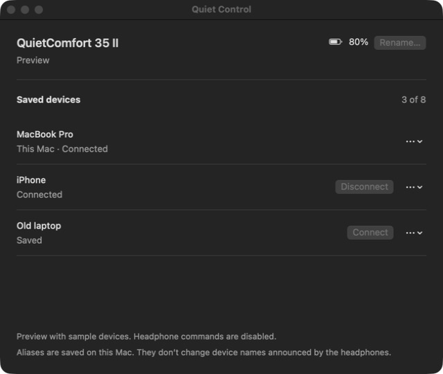
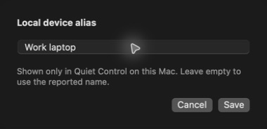

# Quiet Control

A macOS app for managing devices paired with Bose QC35 II headphones.



Read saved devices, connection status, and battery level. Connect, disconnect,
or forget other devices, rename the headphones, and set local device aliases.
The controlling Mac is protected from disconnect and forget actions.

**Aliases stay on this Mac.** They do not change names stored or announced by
the headphones. See [Protocol](#protocol).

Reads, headphone rename, and forget are tested on hardware. Connect and
disconnect still need hardware verification. Refresh after an uncertain result before
sending another command.

## Build and run

Requires macOS 14+ and Swift 6 (Xcode or Command Line Tools).

```sh
git clone https://github.com/altaywtf/quiet-control.git
cd quiet-control
sh scripts/verify.sh
open 'dist/Quiet Control.app'
```

Connect the headphones in System Settings → Bluetooth, then select them in
Quiet Control and choose **Read headphones**. Allow Bluetooth access if asked.
Use **Refresh** to read changes.

The app is signed ad hoc, not notarized. No third-party packages or telemetry.

## Preview and diagnostics

Quit the app before using either launch option:

```sh
open 'dist/Quiet Control.app' --args --demo
'dist/Quiet Control.app/Contents/MacOS/QuietControl' --inspect-protocol
```

Demo mode uses sample devices, keeps aliases in memory, and disables headphone
commands. The screenshots show this mode.



Protocol inspection requires exactly one Bose headphone connected. It sends
read-only queries and omits device names, addresses, and serial numbers.
See [Protocol](#protocol) for packet definitions.

## Protocol

Peer aliases stay local. Bose Connect 25.2's device-management packet factory
has no supported write path for peer names. One authorized SET_GET probe of
peer Info on firmware 4.8.1 returned error 5 (unsupported operator). That
rules out the tested path, not every undocumented setter.

| Function                  | Request                          | Finding                                            |
| ------------------------- | -------------------------------- | -------------------------------------------------- |
| Peer info                 | `04 05 01 06` + six-byte address | Only GET builder present; no name writer           |
| Extended peer info        | Function `04 06`                 | Enum exists, but no builder or response parser     |
| Headphone name            | Function `01 02`                 | Separate from saved peer names                     |
| Get all functions         | `00 04 05 00`                    | START, no payload; not a GET with a block selector |
| Supported function blocks | `00 02 01 00`                    | Big-endian bitset; bit N denotes block N           |

Peer-info response payload:

- Bytes 0–5: Bluetooth address, display order.
- Byte 6: bit 0 connected, bit 1 local/controller, bit 2 Bose product.
- Normal peer: UTF-8 name starts at byte 9.
- Bose peer: product ID in bytes 7–8, variant in byte 9; name starts at byte 10.

Responses and diagnostics:

- Connection actions emit PROCESSING (7) before the terminal RESULT (6). A
  processing acknowledgement does not prove the action completed.
- Surface an ERROR (4) response directly, without waiting for timeout.
- Error 5 means unsupported operator; alone, it does not prove authentication
  is required.
- `--inspect-protocol` repeats the bounded read-only diagnostic. The app has no
  write probe.
- Further undocumented writes need separate authorization. Never sweep opcodes
  or probe firmware or debug writes.

## Credits

- [based-connect](https://github.com/Denton-L/based-connect/blob/ef66145bf4739ec96c1a6959f63146d12ba87e4c/based.c)
  (GPL-3.0): wire-protocol reference. Quiet Control implements the messages independently.
- [bose-macos-utility](https://github.com/lukasz-zet/bose-macos-utility/blob/a4c919f0cfce739f7408d1def190171218df0a6f/bose-macos-utility/bose-macos-utility/AppDelegate.swift)
  (MIT): macOS RFCOMM service discovery.
- Research sources: [iclemens/bose](https://github.com/iclemens/bose/blob/fed1311fc84aa53e59053abfc001e5fedade2ef7/wireshark/bose.lua),
  [aaronsb/bosectl](https://github.com/aaronsb/bosectl/blob/c46a1f607ee717b958dd9f880f7dbb2344b2f543/NOTES.md),
  and Bose Connect packet definitions. No APK or decompiled source is included.

[MIT licensed](LICENSE). Unaffiliated with Bose.
